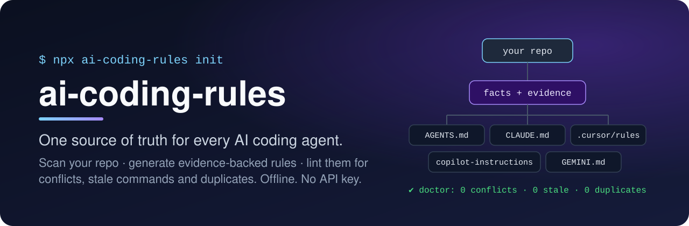
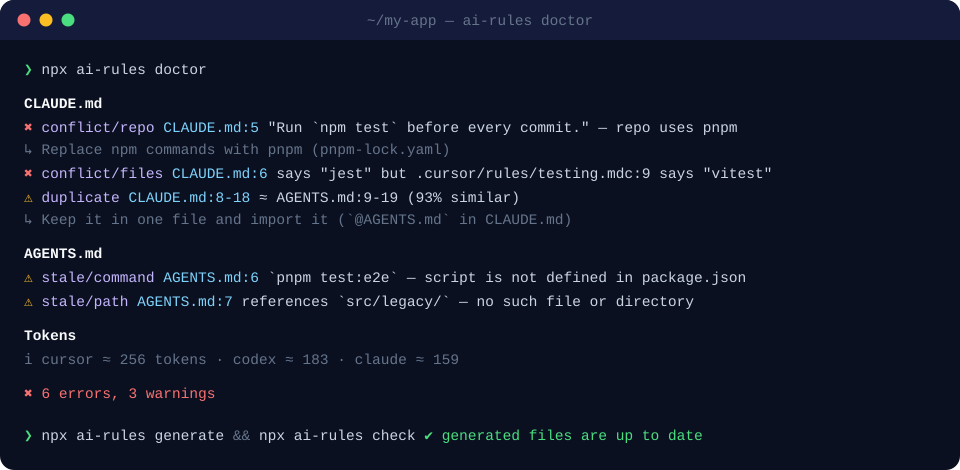

<div align="center">



<br>

**Stop your AI agents from following rules that are wrong, stale or contradictory.**<br>
Generate `AGENTS.md`, `CLAUDE.md`, Cursor, Copilot and Gemini instructions from what your repo *actually* uses —<br>
then lint them like code.

<br>

[](https://github.com/lehongphuong/ai-coding-rules/actions/workflows/ci.yml)
[](./LICENSE)
[](./package.json)
[](#-local-first)
[](./CONTRIBUTING.md)

[Quick start](#-quick-start) · [Why](#-why) · [Doctor](#-doctor-a-linter-for-ai-instructions) · [Stacks](#-supported-stacks) · [CI](#-keep-it-green-in-ci) · [Docs](#-documentation)

</div>

---

## ⚡ Quick start

```bash
npx github:lehongphuong/ai-coding-rules init      # scan → choose agents → generate files
npx github:lehongphuong/ai-coding-rules doctor    # lint every AI instruction file in the repo
```

> [!NOTE]
> The npm release is coming soon. Until then, `npx github:lehongphuong/ai-coding-rules` runs the latest version straight from GitHub; afterwards it's just `npx ai-coding-rules`.

That's it. No config, no account, no API key. Works on any repo — the tool reads your lockfiles, manifests and configs and writes rules your agents can trust.

> [!TIP]
> If this saves you from even one hallucinated `npm install` in a pnpm repo, please **⭐ star the repo** — it really helps other developers find it.

## 🤔 Why

Every team using Claude Code, Cursor, Copilot or Codex ends up with a pile of instruction files. Then this happens:

| 😩 The usual mess | ✅ With ai-coding-rules |
|---|---|
| `CLAUDE.md` says **npm**, the repo moved to **pnpm** months ago | Rules are generated from `pnpm-lock.yaml`, not from memory |
| `CLAUDE.md` says **Jest**, `.cursor/rules` says **Vitest** | `doctor` flags the conflict with file and line |
| `AGENTS.md` mentions `pnpm test:e2e` — the script was deleted | `stale/command` catches it |
| The same 40 lines pasted into 4 files, eating context tokens | `duplicate` + token budget per agent |
| Regenerating wipes your hand-written notes | Managed blocks — your text is never touched |
| Rule generators need an API key and upload your code | 100% local and deterministic |

### What makes it different

- 🔎 **Evidence-backed rules** — every rule knows *why* it exists (`Use pnpm` ← `pnpm-lock.yaml`). Nothing is invented: commands come from your real scripts.
- 🩺 **A linter for AI instructions** — finds contradictions between files, between files and the repo, dead commands, dead paths and copy-paste.
- 🎯 **One source, five targets** — `AGENTS.md`, `CLAUDE.md`, `.cursor/rules/*.mdc`, Copilot instructions, `GEMINI.md`, always in sync.
- 🧩 **Monorepo-aware** — a Flutter app and a NestJS API in one repo get their own scoped rules (nested `AGENTS.md`, Cursor `globs`, Copilot `applyTo`).
- 🛡️ **Safe to re-run** — generated content lives in managed blocks; edits outside them are preserved byte-for-byte.
- 🚦 **CI gate** — `check` fails the build when instruction files drift from the code.

## 🩺 Doctor: a linter for AI instructions

<div align="center">

</div>

| check | catches |
|---|---|
| `conflict/repo` | an instruction that contradicts the repo (npm vs pnpm, Jest vs Vitest, 4 vs 2 spaces) |
| `conflict/files` | two instruction files that disagree with each other |
| `stale/command` | `npm run x` / `make x` / `pnpm x` where `x` no longer exists |
| `stale/path` | references to files or folders that were moved or deleted |
| `duplicate` | near-identical blocks copied across files (with % similarity) |
| `budget` | token cost per file and per agent |
| `legacy` | `.cursorrules`, `.windsurfrules` → migration hints |
| `empty` | instruction files with no actual content |

Output as human text, `--format json`, or `--format sarif` for GitHub code-scanning annotations. Details: [docs/doctor-checks.md](./docs/doctor-checks.md).

## 📄 What gets generated

Real output for a NestJS + pnpm + Prisma project (`--with-evidence` shows where each rule comes from):

```markdown
## Commands
- Use `pnpm` for all dependency commands; do not use npm, yarn or bun. <!-- from: pnpm-lock.yaml -->
- Test: `pnpm test` <!-- from: package.json#scripts.test -->
- E2E: `pnpm test:e2e` <!-- from: package.json#scripts.test:e2e -->
- Migrate: `pnpm db:migrate` <!-- from: package.json#scripts.db:migrate -->

## Code style
- Format with Prettier (`pnpm format`) before committing. <!-- from: .prettierrc, package.json#scripts.format -->
- Do not use `any`; prefer `unknown` and narrow with type guards. <!-- from: tsconfig.json#compilerOptions.strict -->
```

Not sure where a rule came from? Ask:

```console
$ npx ai-rules explain common/package-manager
common/package-manager
  pack     common
  scope    root
  section  commands
  text     Use `pnpm` for all dependency commands; do not use npm, yarn or bun.
  evidence
    - pnpm-lock.yaml
```

## 🧱 Supported stacks

| ecosystem | detected |
|---|---|
| **JavaScript / TypeScript** | React, Next.js, Vue, Nuxt, Angular, Svelte, NestJS, Express, Fastify · npm / pnpm / yarn / bun · Jest, Vitest, Mocha, Playwright, Cypress · ESLint, Biome, Prettier · Prisma, TypeORM, Drizzle, Mongoose · Tailwind, Zustand, Redux, Pinia |
| **Flutter / Dart** | Flutter, Riverpod, Bloc, Provider, GetX · build_runner · flutter_lints, very_good_analysis |
| **PHP** | Laravel, Symfony · Pest, PHPUnit · Larastan/PHPStan, Pint, PHP-CS-Fixer · Eloquent |
| **Python** | Django, FastAPI, Flask · pip, Poetry, uv, Pipenv · pytest · Ruff, Black, Flake8 · SQLAlchemy |
| **Go** | modules, `go test`, golangci-lint, gofmt, GORM, `go.work` |
| **JVM** | Spring, Android, Kotlin · Gradle, Maven · JUnit, ktlint, detekt |
| **Monorepos** | pnpm / npm / yarn workspaces, Turborepo, Nx, Lerna, Melos — and multi-stack repos without a tool |
| **CI** | GitHub Actions, GitLab CI, CircleCI, Bitbucket Pipelines, Azure Pipelines |

Missing your stack? Detectors are small pure functions — [add one](./docs/writing-detectors.md) in an afternoon.

## 🎯 Targets

| target | files written |
|---|---|
| `agents` | `AGENTS.md` (root + one per workspace) — read by Codex, Cursor, Copilot and many more |
| `claude` | `CLAUDE.md` — imports `@AGENTS.md` by default so nothing is duplicated |
| `cursor` | `.cursor/rules/*.mdc` with `globs` / `alwaysApply` |
| `copilot` | `.github/copilot-instructions.md` + `.github/instructions/*.instructions.md` (`applyTo`) |
| `gemini` | `GEMINI.md` |

```bash
npx ai-rules generate --target agents,claude,cursor,copilot,gemini --diff
```

## 🚦 Keep it green in CI

```yaml
# .github/workflows/ai-rules.yml
on: [push, pull_request]
jobs:
  ai-rules:
    runs-on: ubuntu-latest
    steps:
      - uses: actions/checkout@v4
      - uses: lehongphuong/ai-coding-rules/action@main
        with:
          sarif: true   # findings show up as PR annotations
```

<sub>The Action installs the CLI from npm, so it becomes available with the first npm release.</sub>

Prefer something else? Run `npx github:lehongphuong/ai-coding-rules check` in any CI, or use the `ai-rules-check` [pre-commit](https://pre-commit.com) hook. See [docs/ci.md](./docs/ci.md).

## 🔒 Local-first

- Runs fully offline; scanning a typical repo takes well under a second.
- No telemetry, no account, no API key.
- An LLM step exists but is **opt-in only** (`generate --ai` with Ollama, Anthropic or OpenAI). AI-suggested rules are marked *inferred*, and secret files are never sent. See [docs/ai.md](./docs/ai.md).

## 🛠️ Commands

| command | what it does |
|---|---|
| `init` | Scan, choose targets, write `.ai-rules/config.yaml`, generate |
| `scan` | Show detected facts with evidence (`--json` for tooling) |
| `generate` | Write instruction files (`--target`, `--dry-run`, `--diff`, `--force`, `--with-evidence`, `--ai`) |
| `doctor` | Lint all instruction files (`--format human\|json\|sarif`, `--strict`) |
| `check` | CI gate: doctor + "are generated files up to date?" |
| `explain <query>` | Show which files and facts a rule comes from |

Installed locally (`npm i -D ai-coding-rules`) the CLI is also available as `ai-rules`.

## 📚 Documentation

[Configuration](./docs/configuration.md) · [Commands](./docs/commands.md) · [Doctor checks](./docs/doctor-checks.md) · [CI](./docs/ci.md) · [Optional AI](./docs/ai.md) · [Writing detectors](./docs/writing-detectors.md) · [Writing rule packs](./docs/writing-rule-packs.md) · [Design (PLAN)](./PLAN.md) · [Spec](./SPEC.md)

## 🗺️ Roadmap

- [x] Scanner with evidence for 6 ecosystems + monorepos
- [x] Generate 5 targets with managed blocks
- [x] Doctor: conflicts, stale commands/paths, duplicates, token budget
- [x] `check`, GitHub Action, SARIF, pre-commit
- [x] Opt-in AI enhancement (Ollama / Anthropic / OpenAI)
- [ ] Windsurf target, Docker & more detectors
- [ ] `--verify`: run detected commands to prove they work
- [ ] `doctor --fix` for safe automatic fixes
- [ ] Validate `doctor` on 20+ popular open-source repos

Ideas and votes welcome in [issues](https://github.com/lehongphuong/ai-coding-rules/issues).

## 🤝 Contributing

The most valuable contributions are **new detectors**, **rule packs for your stack**, and **doctor false-positive reports** (there's an issue template for each). Start with [CONTRIBUTING.md](./CONTRIBUTING.md).

```bash
git clone https://github.com/lehongphuong/ai-coding-rules && cd ai-coding-rules
npm install && npm test
```

<div align="center">

---

**If ai-coding-rules makes your AI agents a little less wrong, give it a ⭐ — it helps more than you think.**

[](https://star-history.com/#lehongphuong/ai-coding-rules&Date)

MIT © ai-coding-rules contributors

</div>
